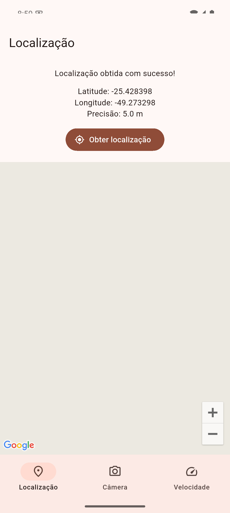
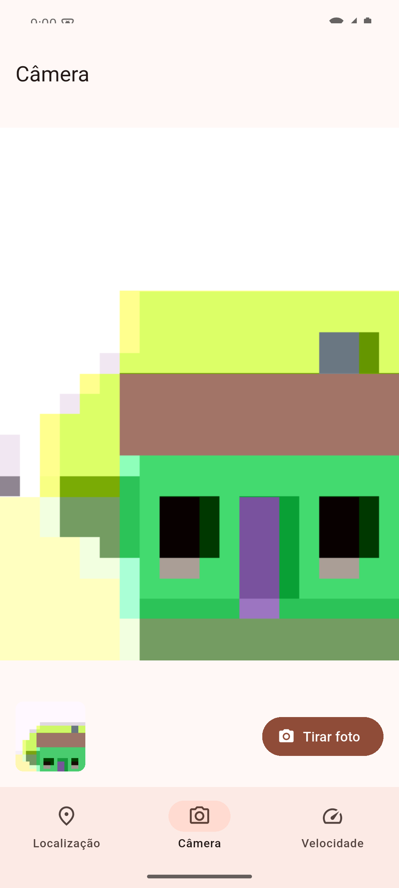
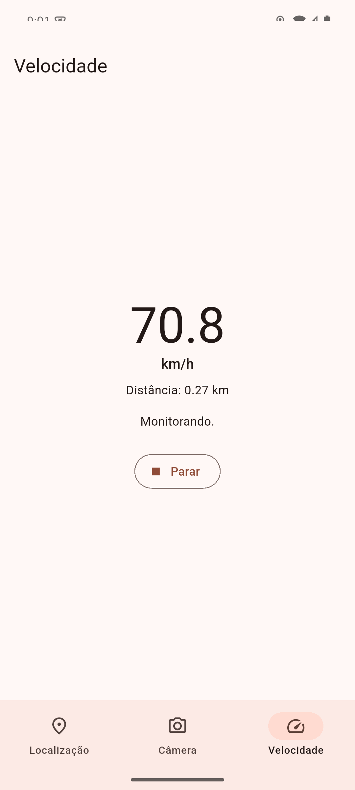
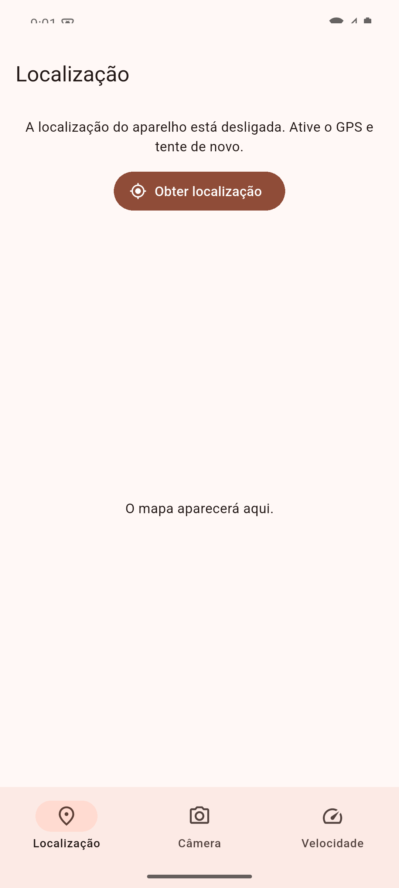
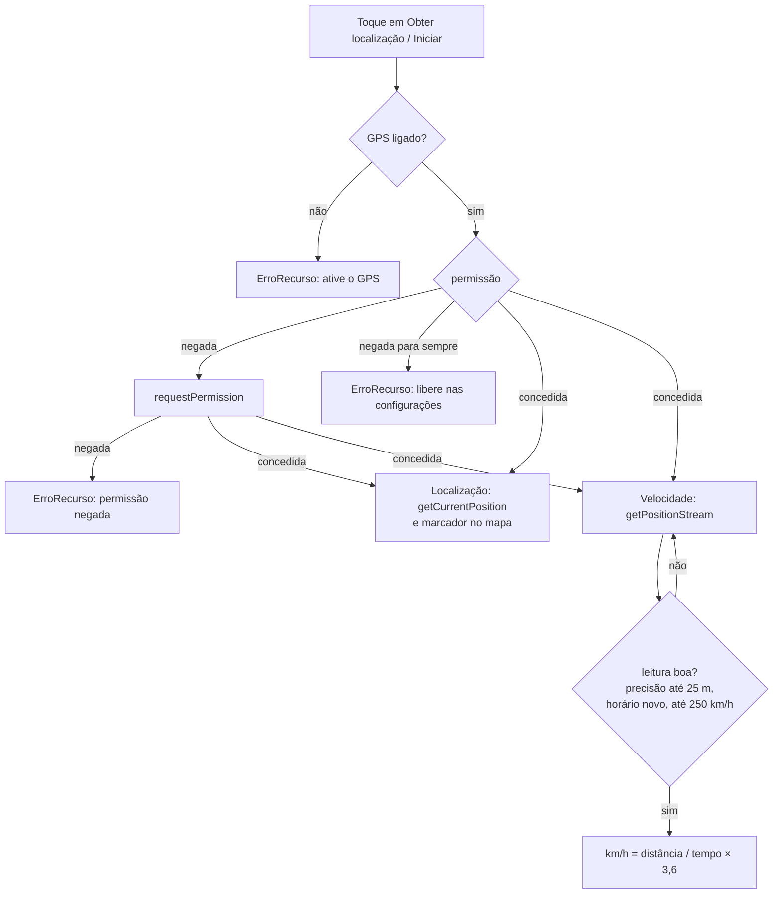

# Aula 07: Explorador Móvel

Disciplina **Tecnologias Móveis e Híbridas** (ADS, Senac São José dos Pinhais). Os demais exercícios da matéria estão em [flutter-class](https://github.com/PeSzpak/flutter-class).

App com três abas que usam recursos nativos do celular:

| Localização | Câmera | Velocidade | GPS desligado |
|---|---|---|---|
|  |  |  |  |

| Aba | O que faz | Pacote |
|---|---|---|
| Localização | Pede permissão, mostra latitude, longitude e precisão, e um mapa com marcador na posição | `geolocator`, `google_maps_flutter` |
| Câmera | Abre a câmera traseira, mostra a pré-visualização e tira uma foto (miniatura no canto) | `camera` |
| Velocidade | Iniciar/parar o monitoramento; calcula km/h pela distância entre leituras do GPS dividida pelo tempo | `geolocator` |

**Tratamento de erros:** GPS desligado, permissão negada, permissão negada para sempre, sinal fraco ou demora (timeout de 20 s), aparelho sem câmera, câmera ocupada ou sem permissão, e falha ao capturar.

**Filtro de leituras ruins (velocidade):** descarta leituras com precisão pior que 25 m, com o mesmo horário da anterior ou que dariam mais de 250 km/h (salto de GPS). A regra fica em `lib/velocidade.dart` e é testada sem GPS em `test/widget_test.dart`, inclusive com o exemplo do slide: 100 m em 20 s = 18 km/h.

**Recursos liberados:** cada aba é criada quando é aberta; ao trocar de aba, o `CameraController` e a assinatura do GPS são encerrados no `dispose()`.

## Como funciona a localização e a velocidade



`lib/permissoes.dart` faz as checagens de GPS e permissão e lança `ErroRecurso` com a mensagem pronta para a tela. `lib/velocidade.dart` é Dart puro (sem plugin), por isso dá para testar o cálculo sem GPS.

**Stack:** Flutter (Material 3, `NavigationBar`), Dart, `geolocator`, `google_maps_flutter`, `camera`.

## Estrutura

```
lib/
  main.dart              NavigationBar com as três abas
  localizacao_tela.dart  posição atual + GoogleMap com marcador
  camera_tela.dart       CameraController, pré-visualização e foto
  velocidade_tela.dart   monitoramento contínuo do GPS
  velocidade.dart        filtro de leituras e cálculo de km/h
  permissoes.dart        GPS ligado e permissão de localização
test/widget_test.dart    cálculo de velocidade, distância e troca de abas
prints/                  capturas do APK no emulador
```

**APK release:** [v1.0.0](https://github.com/PeSzpak/explorador-movel/releases/tag/v1.0.0). Foi gerado sem a chave do Maps, então o mapa aparece cinza.

## Chave do Google Maps

O mapa precisa de uma chave da Maps SDK for Android. Ela não vai para o git: coloque em `android/local.properties`:

```properties
MAPS_API_KEY=sua_chave_aqui
```

Sem a chave, o app funciona e a posição aparece, mas o mapa fica cinza.

## Testado no emulador (16/11/2026)

APK release instalado num emulador Android 15 (API 35). As capturas estão em [`prints/`](prints):

1. **Localização:** posição simulada em Curitiba (`adb emu geo fix`), precisão de 5 m, com a permissão pedida na primeira vez. O mapa ficou cinza por falta da chave.
2. **Câmera:** pré-visualização da câmera virtual do emulador e foto capturada.
3. **Velocidade:** trajeto simulado com uma posição a cada 2 s, mostrando 70,8 km/h e 0,27 km.
4. **GPS desligado:** mensagem "A localização do aparelho está desligada. Ative o GPS e tente de novo."

O enunciado pede o teste no **celular físico**. No emulador, o GPS e a câmera são simulados.

```bash
flutter test
flutter run                     # com o celular conectado
flutter build apk --release
```
